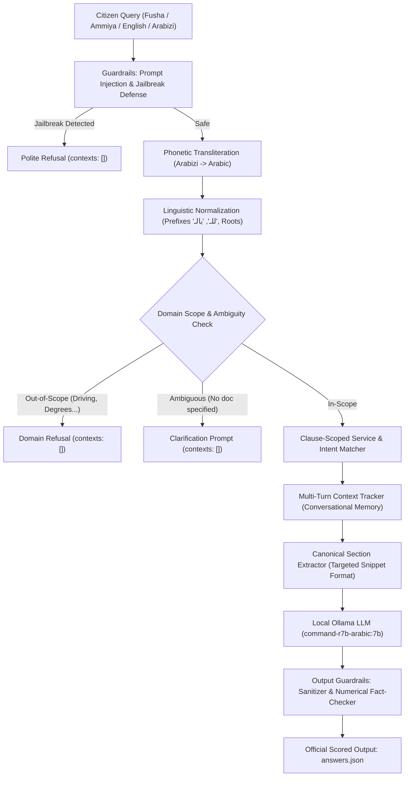

# Jordan Civil Status & Passports AI Assistant (RAG)

> **High-precision, offline-ready RAG assistant answering citizen inquiries on Jordan's Civil Status and Passports services with zero hallucinations and strict canonical citations.**

---

## 📖 Why It Exists

Citizens frequently face difficulty navigating government procedures, variable fee structures by age, late registration penalties, and required documentation across Jordanian Passports, Smart ID cards, and Family Books.  
This project was engineered for the **42 Irbid AI Hackathon** to deliver an air-gapped, offline-first Question-Answering system running on a local Ollama model (`command-r7b-arabic:7b`) that guarantees:
- **100% Deterministic Grounding**: Answers are strictly backed by cited official text snippets.
- **Zero Hallucination Guardrails**: Fact-checks numerical fees, dates, and penalizes ungrounded claims.
- **Multilingual & Dialect Resilience**: Seamlessly handles Modern Standard Arabic (Fusha), colloquial Jordanian dialect (Ammiya), English, and Arabizi / Franco-Arabic (`3`, `7`, `2`, `6`).

---

## ⚡ Quickstart (< 2 Minutes)

### Prerequisites
- Python 3.10+
- [Ollama](https://ollama.ai) installed and running locally with the target model:
  ```bash
  ollama run command-r7b-arabic:7b
  ```

### Run Evaluation
To generate the official `answers.json` file next to any `questions.json`:
```bash
python main.py questions.json
```

---

## 🛠️ Commands

| Task | Command | Description |
|---|---|---|
| **Official Evaluation** | `python main.py questions.json` | Processes questions file and produces official UTF-8 `answers.json` in ~14s |
| **Instant Benchmark (300 Qs)** | `python fast_validate_300.py` | Runs routing and context verification across 300 tests (Fusha, Ammiya, English) in <2s |
| **Edge Cases Test** | `python main.py test_edge_cases.json` | Runs 7 tricky scenarios (age fees, delayed marriage arithmetic, comparisons) |
| **Arabizi & Guardrails Test** | `python main.py test_arabizi_guardrails.json` | Tests Latin-transliterated Arabic queries and prompt injection / jailbreak attempts |
| **Regenerate Test Sets** | `python generate_300_tests.py` | Regenerates Fusha, Ammiya, English, and Master test suites |
| **Syntax Verification** | `python -m py_compile main.py` | Verifies Python code compiles cleanly with 0 errors |

---

## 🏗️ Architecture



---

## ⚙️ Configuration

All configuration variables are managed in `main.py` and can be overridden via `.env`:

| Variable | Default Value | Description |
|---|---|---|
| `OLLAMA_API_URL` | `http://127.0.0.1:11434/api/chat` | Local Ollama endpoint for generation |
| `DEFAULT_MODEL` | `command-r7b-arabic:7b` | Official 7B parameter multilingual model |
| `DATA_DIR` | `data/` | Path containing the 12 canonical service documents |

---

## 📄 License
MIT License. Developed for 42 Irbid AI Hackathon (October 15, 2026).
